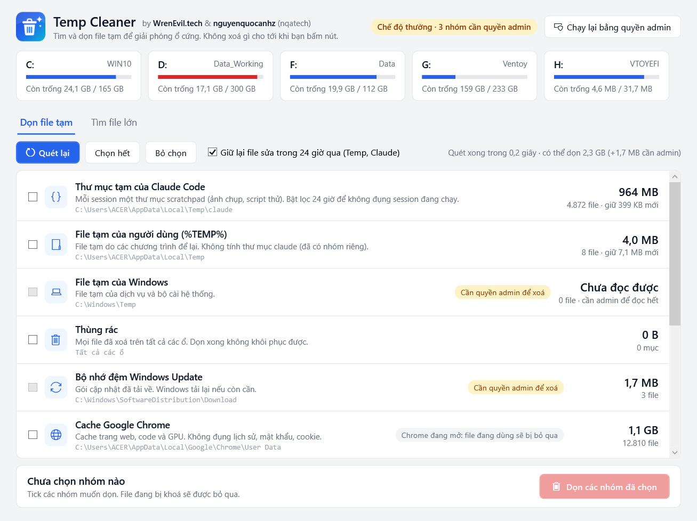

<p align="center">
  
</p>

# Temp Cleaner

App Windows (WPF, .NET 8) tìm và dọn file tạm để giải phóng ổ cứng. App quét và hiện dung lượng từng nhóm trước, **chỉ xoá khi bạn tick nhóm đó và bấm nút**.



## Tính năng

- Quét và hiện dung lượng các nhóm:
  - thư mục tạm của Claude Code (`%TEMP%\claude`)
  - `%TEMP%` của người dùng và `C:\Windows\Temp`
  - Thùng rác
  - bộ nhớ đệm Windows Update (`SoftwareDistribution\Download`)
  - cache Chrome, Edge, Firefox
  - thumbnail cache
  - crash dump của ứng dụng và của hệ thống
- Tuỳ chọn **giữ lại file sửa trong 24 giờ qua**, để không đụng vào chương trình hay session Claude Code đang chạy.
- File đang bị khoá được bỏ qua, app không crash. Sau khi dọn, app báo số file đã xoá, số bỏ qua và dung lượng thực sự giải phóng.
- Không đi vào junction/symlink, nên không xoá nhầm ra ngoài thư mục đích.
- Các nhóm cần quyền admin được đánh dấu rõ, có nút **Chạy lại bằng quyền admin**.
- Tab **Tìm file lớn**: quét một ổ (mặc định D:) và ổ ảo WSL/Docker trên C: để tìm ISO, `.vhdx` và các file lớn khác. Tab này **chỉ liệt kê, không xoá**.

## Tải về

Vào [Releases](https://github.com/nguyenquocanhz/temp-cleaner/releases/latest) để tải:

- `TempCleaner-Setup-x.y.z.exe`: bộ cài, mặc định cài cho riêng bạn nên không cần admin. Có shortcut Start Menu và mục gỡ trong Settings.
- `TempCleaner-x.y.z-win-x64-portable.zip`: giải nén ra là chạy, không cần cài.

Cả hai bản đều đã kèm .NET, chạy trên Windows 10/11 64-bit.

## Build và chạy

Cần .NET 8 SDK.

```bash
dotnet build -c Release
```

```bash
bin\Release\net8.0-windows\TempCleaner.exe
```

Tham số dòng lệnh (dùng để kiểm thử): `--autoscan`, `--tab big`, `--bigscan D:\`, `--screenshot file.png`, `--exit`.

Đóng gói bộ cài (cần Inno Setup 6: `winget install JRSoftware.InnoSetup`), kết quả nằm trong `dist\`:

```bash
powershell -ExecutionPolicy Bypass -File tools\build-installer.ps1
```

## Logo

Nguồn vector nằm ở `Assets/logo.xaml` và `Assets/banner.xaml`. Xuất lại PNG và `app.ico`:

```bash
powershell -STA -ExecutionPolicy Bypass -File tools\render-logo.ps1
```

## Tác giả

**WrenEvil.tech** & **nguyenquocanhz (nqatech)**

## Giấy phép

[MIT](LICENSE)
